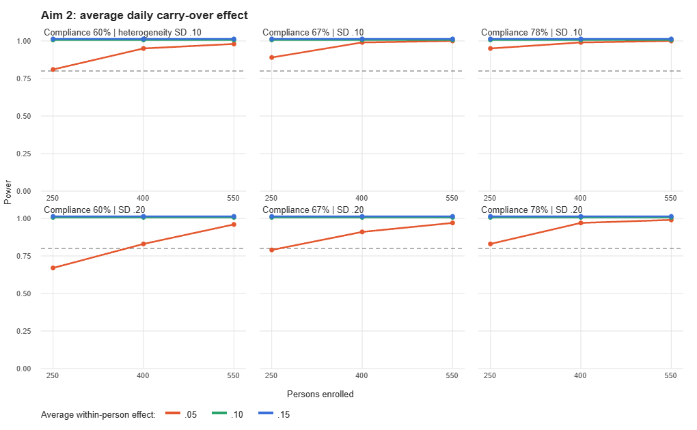
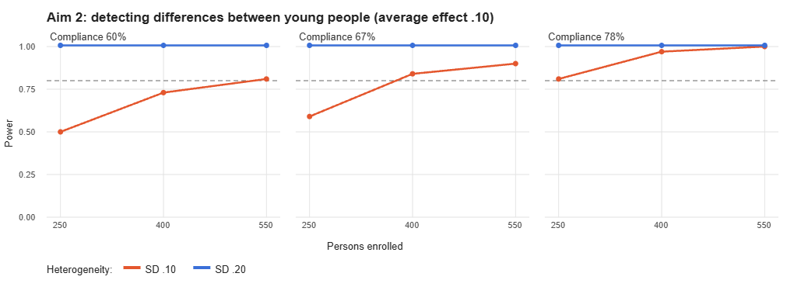
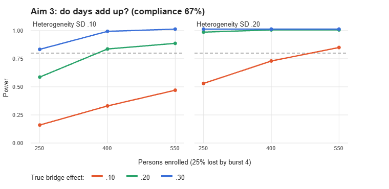

## 1. Question

Is the planned measurement-burst study large enough? About 400 young adults (18–25) will be enrolled and ~300 retained, across four 14-day bursts six months apart, with four prompts a day. The simulation asks three things:

1. **Average daily effect.** Can the study detect a small within-person carry-over effect of digital exposure on later mood (e.g., late-night AI use → next-prompt mood)?
2. **For whom.** Can it detect that this effect differs between young people (between-person variance of the within-person effect)?
3. **Do days add up?** Can a young person's daily effect at one burst predict their full-scale wellbeing six months later, controlling for earlier wellbeing?

## 2. Assumptions (from the literature where available)

| Parameter | Values | Source |
|---|---|---|
| Prompts per burst | 56 (14 days × 4) | Study design |
| Compliance | **78%** (pooled youth EMA); **67%** (clinical youth, 4–5 prompts/day); **60%** (conservative; applicant's 2025 study) | Wen et al., 2017, *JMIR* 19(4):e132 |
| Average within-person effect (standardised) | .05 / .10 / .15 | Beyens et al., 2020, *Sci Rep* 10:10763: no average effect of passive use; average active-use effect B = .07; 44% of adolescents with person-specific effects between −.10 and .10 |
| Between-person SD of that effect | .10 / .20 | Beyens et al., 2020: person-specific effects ranged from −.24 to .68 (.20 ≈ that heterogeneity) |
| Mood autoregression; ICC | .30; .40 | Design assumptions, to be replaced by pilot estimates |
| Retention across bursts | 100 / 92 / 84 / 75% | Study design (~400 → ~300) |
| Stability of person effects across bursts; of wellbeing over 6 months | .70; .60 | Design assumptions |
| Bridge effect (Q3) | .10 / .20 / .30 | No direct literature: a sensitivity range |

All parameters and sources are listed in `assumptions.csv`. 150 replications per cell (Monte Carlo SE ≈ .03 near power .80); α = .05 two-sided.

## 3. Method

Data were generated from a two-level lagged model: mood at each prompt depends on mood at the previous prompt that day and on digital exposure at the previous prompt, with a person-specific exposure effect. Compliance varied between persons around the mean. Lags were only formed between consecutive prompts on the same day.

- **Q1–Q2:** multilevel model with person-mean centring (lme4), random intercept and random exposure slope. Fixed effect tested by z; slope variance by likelihood-ratio test (50:50 χ² mixture).
- **Q3:** each burst modelled separately; empirical-Bayes person slopes at burst *k* predict wellbeing at burst *k*+1, controlling wellbeing at *k* (mixed model, random intercept).

This approximates the planned dynamic structural equation models (DSEM, Mplus). Latent-centred DSEM Monte Carlo templates for the same cells are included (`mplus/templates`) for confirmation on a computing cluster (Schultzberg & Muthén, 2018, *Struct Equ Modeling* 25:495).

## 4. Results

**Usable observations.** Because lags are only formed within days, usable lagged pairs per person were ~16 (60% compliance), ~20 (67%) and ~26 (78%) per burst. This is fewer than the raw number of completed prompts.

**Q1: average daily effect.** At 400 enrolled, power was ≥ .83 for the smallest effect (.05) in every compliance and heterogeneity condition, and 1.00 for effects ≥ .10 (Figure 1). Estimates were unbiased (mean bias < .005).

**Q2: for whom.** Beyens-level heterogeneity (SD = .20) was detected with power 1.00 in every condition. Modest heterogeneity (SD = .10) was detected at 400 enrolled with power .73 (60% compliance), .84 (67%) and .97 (78%) (Figure 2).

**Q3: do days add up?** This is the limiting test (Figure 3). At 400 enrolled (~300 at burst 4), 67% compliance:

| True bridge effect | Heterogeneity SD .10 | Heterogeneity SD .20 |
|---|---|---|
| .10 | .33 | .73 |
| .20 | .83 | 1.00 |
| .30 | .98 | 1.00 |

Two-step estimates were strongly attenuated (e.g., a true effect of .20 was estimated at ~.07 with SD .10), because person-specific effects estimated from ~20 lagged pairs are unreliable. Latent DSEM should remove most of this bias; its effect on power is checked in the Mplus templates.

## 5. Decision

- **N ≈ 400 enrolled is adequate for Aim 2:** the average daily effect, even at the small end of the literature, and Beyens-level differences between young people.
- **Aim 3 is adequately powered for bridge effects ≥ .20, not for effects of .10** unless heterogeneity is large. The bridge test is therefore preregistered as confirmatory for effects ≥ .20, with smaller effects reported as estimates with intervals.
- **Design levers if the pilot shows lower heterogeneity or compliance:** more prompts per day with within-day lags, longer bursts, or enrolling ~550, which raises bridge power for a .10 effect to .47–.85.
- **In months 7–12**, pilot estimates (compliance, autoregression, ICC, heterogeneity) replace the design assumptions and the grid is re-run in Mplus DSEM before the final N is fixed.

## 6. Limitations

The data-generating model is idealised: normal errors, exposure measured without error, missingness at random, and a correctly specified model. Real data are likely to give lower power, so these results are an upper bound for given effect sizes. The bridge effect has no direct empirical anchor. The lme4 approximation uses observed rather than latent person-mean centring.

## References

Beyens, I., Pouwels, J. L., van Driel, I. I., Keijsers, L., & Valkenburg, P. M. (2020). The effect of social media on well-being differs from adolescent to adolescent. *Scientific Reports, 10*, 10763. https://doi.org/10.1038/s41598-020-67727-7

Schultzberg, M., & Muthén, B. (2018). Number of subjects and time points needed for multilevel time-series analysis: A simulation study of dynamic structural equation modeling. *Structural Equation Modeling, 25*(4), 495–515. https://doi.org/10.1080/10705511.2017.1392862

Wen, C. K. F., Schneider, S., Stone, A. A., & Spruijt-Metz, D. (2017). Compliance with mobile ecological momentary assessment protocols in children and adolescents: A systematic review and meta-analysis. *Journal of Medical Internet Research, 19*(4), e132. https://doi.org/10.2196/jmir.6641
